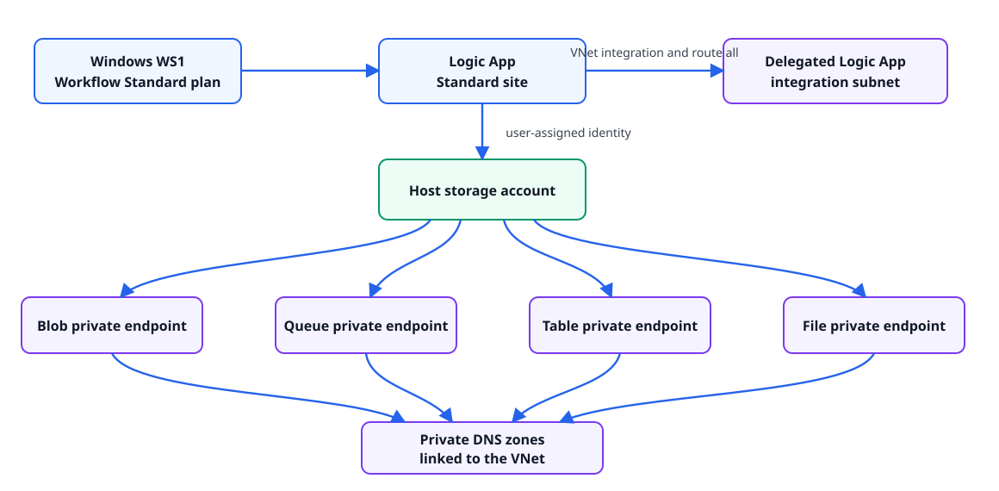

# Logic App Standard infrastructure baseline

Every Logic App in this workshop must use the private-networked Logic App
Standard pattern from the following source implementations:

- [Bicep reference](https://github.com/scallighan/logic-app-doc-processing/tree/main/bicep)
- [Terraform reference](https://github.com/scallighan/logic-app-doc-processing/tree/main/terraform)

Read the matching reference implementation before generating or changing a lab
deployment. The reference repository is the source of truth for the resources,
settings, dependencies, and managed-identity wiring in the scope below. Do not
replace this pattern with a Consumption Logic App, a public host-storage
connection string, or a simplified Standard deployment.

## Required resource graph

Lab 0 deploys one shared Logic App hosting foundation for the entire workshop.
Labs 1-3 reference it; they do not create another foundation:

Lab 0 also deploys Cosmos DB, the Service Bus namespace, and monitoring. Later
labs add workflow artifacts, messaging entities, frontend resources, and
explicitly selected extensions; they do not replace or weaken this graph.

## Reference-matched requirements

| Area | Required implementation |
|---|---|
| Virtual network | Use the reference `172.22.0.0/16` address space and its four `/24` subnets: default, Container Apps environment, private endpoints, and Logic App integration. Disable default outbound access on each subnet. Preserve the `Microsoft.App/environments` and `Microsoft.Web/serverFarms` delegations from the reference. Parameterize the address prefixes only if a lab must fit an existing network. |
| Host storage | Use a `StorageV2`, `Standard_LRS`, Hot account with HTTPS-only traffic, TLS 1.2 minimum, and blob public access disabled. Never use an account key or connection string. |
| Storage private connectivity | Create separate blob, queue, table, and file private endpoints in the private-endpoint subnet. Create the corresponding `privatelink` private DNS zones, link them to the VNet, and attach each endpoint to its zone with a private DNS zone group. |
| Host-storage identity | Create a user-assigned managed identity and grant it Storage Blob Data Contributor, Storage Queue Data Contributor, and Storage Table Data Contributor on the host storage account. |
| App Service plan | Use a Windows `WS1` Workflow Standard plan. This and the private endpoints are cost-bearing resources and must be identified before deployment. |
| Logic App | Deploy `Microsoft.Web/sites` as `functionapp,workflowapp` with both system-assigned and host-storage user-assigned identities. Attach it to the delegated Logic App subnet and route all outbound traffic through the VNet. |
| Host settings | Preserve the reference Functions v4, .NET worker, Workflows extension bundle, `APP_KIND=workflowApp`, in-process .NET 8, and PowerShell settings. Configure `AzureWebJobsStorage` with the user-assigned identity resource ID and blob, queue, and table service URIs. Lab-specific settings may be added but must not replace these host settings. |
| Dependencies | Do not create the Logic App site until the plan, host-storage RBAC assignments, and all four storage private endpoints are ready. |

Use the current stable Azure API versions and the repository's pinned Terraform
provider constraints while preserving the reference behavior. If the Bicep and
Terraform reference files differ, report the difference and keep the lab tracks
behaviorally equivalent rather than silently choosing a third design.

Private endpoints do not by themselves prove that public access is disabled.
Review the reference account properties and deployment preview explicitly; do
not invent or weaken a network-access setting.

## Lab workload private connectivity

The shared hosting baseline covers host storage. A lab-specific data service
with public network access disabled also needs a complete private data-plane
path from the Logic App integration subnet.

Lab 0 must create a Cosmos DB `Sql` private endpoint in the private-endpoint
subnet, the `privatelink.documents.azure.com` private DNS zone, a VNet link, and
a private DNS zone group. Keep Cosmos public network access and local
authentication disabled. Create this path in the backend foundation before
deploying the lookup workflow, and verify the endpoint connection, private A
record, and VNet link after deployment. VNet integration and managed identity
alone do not make a private Cosmos account reachable.

## Identity boundaries

The user-assigned identity exists for Logic App host-storage access. Keep each
Logic App's system-assigned identity for lab workload access:

- Lab 0 grants its Logic App system identity only the required Cosmos DB
  data-plane access.
- Separately, Lab 0 grants the confirmed signed-in student user Service Bus
  Data Sender at namespace scope for workshop publishing. Neither Logic App
  identity receives this role.
- Lab 2 grants the selected Logic App system identity receiver access
  separately at each required Service Bus subscription scope, never at
  namespace or topic scope.

Do not replace either identity boundary with shared keys or broaden the
user-assigned identity to all lab data-plane resources.

## Shared Lab 0 ownership

Lab 0 accepts an optional existing parent resource group. Ask the learner for
its name; a blank answer creates a workshop group. An existing group is a
reference, never a managed resource or cleanup target. Its tags and unrelated
resources remain untouched. Lab 0 owns the newly created foundation resources
in either mode.

All later labs require the explicit non-secret `foundation` output saved as
`foundation.deployment.json`. Verify references and compatibility rather than
inferring names, importing resources, or creating fallback foundations.
Keep shared resource tags `lab=00`; later labs own only their additions.

Audit, order-created, and order-cancelled remain independently deployable
workflows in the same site. Its system identity retains Lab 0's container-scoped
Cosmos grant and gains three Lab 2 subscription-scoped receiver roles plus a
Cosmos contributor grant scoped only to Lab 2's new `orders` container in the
existing database. Lab 2 must not change `items` or parent throughput. Explain
this shared-identity cost tradeoff: workflows are not isolated by identity.
The host identity stays storage-only.

The shared app-level `connections.json` must preserve every other lab's
connection entry. Artifact deployment must not erase unrelated workflows.
Later labs must not manage the parent site or replace its full app settings.
Cleanup removes only owned artifacts, messaging children, the Lab 2 container,
and grants; remove
those before Lab 0's foundation. Never delete an existing parent group.

The shared foundation does not change peek-lock, completion, retry, or
dead-letter requirements. Service Bus Standard deliberately uses an
Entra-authorized public endpoint; private networking requires Premium.
