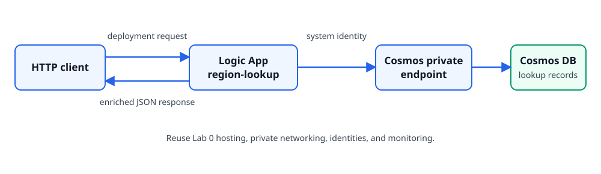

# Lab 1: Lookup and transform

Use Cosmos DB to transform a JSON deployment request. Keep the request details
unchanged, but replace its unverified region labels with lookup values.
The workflow transforms JSON only; it does not deploy Azure resources.

**Time:** 60 minutes. **Required:** [Lab 0](../00-foundation/README.md),
Python 3, and the same Azure CLI session.



This lab uses public data from Microsoft's
[Azure regions list](https://learn.microsoft.com/en-us/azure/reliability/regions-list?tabs=all).
It needs no website or API Management.

## Task 1: populate the lookup table

From the repository root, run:

```bash
python3 scripts/seed-region-lookups.py foundation.deployment.json
```

The script loads [six sample regions](contracts/regions.json) into Lab 0's
`workshop/items` container. It runs a temporary helper workflow inside the
existing site so Cosmos DB stays private. It removes the helper afterward
and leaves the `lab01Cosmos` connection ready for your workflow.
Rerunning the script updates the same six records. If you seeded an earlier
version of this lab, run it again to add the region display names.

## Task 2: generate the workflow

Give Copilot this prompt. Keep the Bicep or Terraform track you chose in Lab 0.

```text
Build the region-lookup HTTP workflow for Lab 1. Follow
labs/01-crud-integration/implementation-requirements.md and its OpenAPI contract.
Use programmaticName to look up Cosmos DB. Preserve requestId, workloadName,
instanceCount, and programmaticName. Replace regionDisplayName and
physicalLocation with lookup values. Reuse Lab 0 and lab01Cosmos; do not
hardcode values. Show the files and checks before deploying.
```

Review the generated workflow and deployment artifacts. Approve deployment
only to the existing Lab 0 site; there should be no foundation changes.
The [implementation requirements](implementation-requirements.md) contain
the connection, lookup, and error-handling details.

## Task 3: send a request

In the Azure portal, open `region-lookup` and copy its HTTP trigger callback
URL. Paste it into the hidden prompt below. Do not save it in a file or commit it.

```bash
read -r -s -p "Workflow callback URL: " WORKFLOW_URL
printf '\n'
curl --silent --show-error --fail-with-body \
  --header 'Content-Type: application/json' \
  --data @labs/01-crud-integration/contracts/sample-request.json \
  "$WORKFLOW_URL"
unset WORKFLOW_URL
```

Request:

```json
{
  "requestId": "REQ-1042",
  "workloadName": "inventory-api",
  "instanceCount": 2,
  "programmaticName": "westus",
  "regionDisplayName": "unresolved",
  "physicalLocation": "unresolved"
}
```

Expected HTTP `200` response:

```json
{
  "requestId": "REQ-1042",
  "workloadName": "inventory-api",
  "instanceCount": 2,
  "programmaticName": "westus",
  "regionDisplayName": "West US",
  "physicalLocation": "California"
}
```

What changed:

| Fields | Rule |
|---|---|
| `requestId`, `workloadName`, `instanceCount`, `programmaticName` | Copy unchanged, including the numeric instance count |
| `regionDisplayName` | Replace with the Cosmos document's `displayName` |
| `physicalLocation` | Replace with the Cosmos document's `physicalLocation` |

## Task 4: check lookup and error behavior

Use the [test cases](contracts/test-cases.json) to check:

| Request | Expected result |
|---|---|
| `westus` | `200`, labels become `West US` and `California` |
| `westeurope` | `200`, labels become `West Europe` and `Netherlands` |
| Different request ID, workload name, or instance count | Preserve the supplied values and types |
| Incorrect incoming region labels | Replace both labels from Cosmos, not from the request |
| `notaregion` | `404`, lookup not found |
| Missing required field or wrong field type | `400`, invalid request |

Only the six seeded regions are available in this exercise. A valid Azure
region that is not seeded also returns `404`. Confirm the workflow reads
Cosmos DB rather than using a hardcoded map, and returns no Cosmos system fields.

## Cleanup

Remove only the `region-lookup` workflow and the `lab01Cosmos` connection entry
if nothing else uses it. Preserve other workflows, connections, and all Lab 0
resources. The six sample documents can remain until Lab 0 cleanup.
