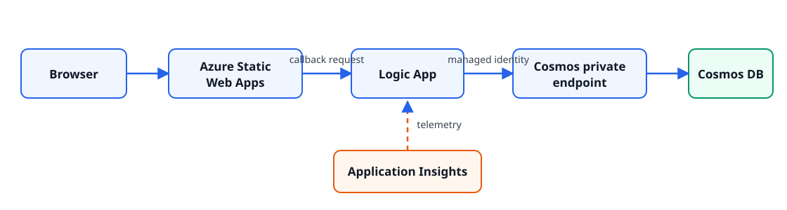

# Lab 1: CRUD integration

Build a small item-management website backed by a Logic App and Azure Cosmos
DB. The learner path connects the website directly to the workflow.

**Time:** 90 minutes

**Required:** complete [Lab 0](../00-foundation/README.md) and keep
`foundation.deployment.json` locally. This lab references its shared site,
Cosmos container, identities, private connectivity, and monitoring; it does
not provision another foundation.

## Learning objectives

- Ground Copilot in an OpenAPI contract and repository instructions.
- Add workflow artifacts and frontend resources through small, reviewable tasks.
- Grant Cosmos DB access through managed identity and least-privilege RBAC.
- Use Copilot to diagnose a deployment or request from exact tool output.

## Architecture



The workshop uses one HTTP-triggered Logic App with explicit operation handling.
[`contracts/openapi.yaml`](contracts/openapi.yaml) defines the operations and
response contract. The `items` Cosmos container uses `/id` as its partition
key.

The workflow is a private-networked Logic App Standard site and must follow
[`docs/logic-app-standard-baseline.md`](../../docs/logic-app-standard-baseline.md).
Its user-assigned identity accesses host storage; its system-assigned identity
accesses Cosmos DB through the Cosmos `Sql` private endpoint and private DNS
zone.

The starter app sends one canonical request shape containing the OpenAPI
`operationId`, optional item ID, body, and correlation ID. The Logic App
switches on `operationId`.

The callback URL authorizes invocation and is visible to the browser for this
exercise. Do not commit, log, or share it; do not persist it in browser storage;
delete the workshop workflow afterward. The workflow must handle CORS preflight
and allow only the Static Web App origin.

## Implementation reference

Read [`implementation-requirements.md`](implementation-requirements.md) before
starting. It defines the target resource graph, identity boundaries, API
Management modes, workflow behavior, and secret-handling requirements for both
IaC tracks. The task prompts below intentionally describe outcomes rather than
repeat those guardrails.

## Choose a track

Use one track for implementation:

- **Bicep:** invoke
  [`.github/prompts/01-crud-bicep.prompt.md`](https://github.com/scallighan/level-up-azure-integration-services/blob/main/.github/prompts/01-crud-bicep.prompt.md)
  and work in `labs/01-crud-integration/iac/bicep/`.
- **Terraform:** invoke
  [`.github/prompts/01-crud-terraform.prompt.md`](https://github.com/scallighan/level-up-azure-integration-services/blob/main/.github/prompts/01-crud-terraform.prompt.md)
  and work in `labs/01-crud-integration/iac/terraform/`.

### Initialize the selected track

Start from the repository root so Copilot can resolve every relative path.
Invoke the prompt for your selected track once. It creates only the initial file
structure, minimal base files, and a path-local `AGENTS.md` containing the
track's mandatory context and guardrails. It does not implement Task 1.

**VS Code Copilot Chat**

1. Open this repository as the VS Code workspace.
2. Open Copilot Chat and select **Agent** mode.
3. Invoke the workspace prompt for your track:

   ```text
   /01-crud-terraform
   ```

   Use `/01-crud-bicep` for the Bicep track.

**GitHub Copilot CLI**

1. In a terminal, change to the repository root and start Copilot:

   ```bash
   cd level-up-azure-integration-services
   copilot
   ```

2. At the interactive Copilot prompt, mention the file with `@`:

   ```text
   @.github/prompts/01-crud-terraform.prompt.md
   ```

   Use `@.github/prompts/01-crud-bicep.prompt.md` for the Bicep track. Typing
   `@` opens file autocomplete; select the prompt rather than entering the text
   as a shell command.

See
[Invoking workshop prompt files](../../docs/copilot-working-agreement.md#invoking-workshop-prompt-files)
for the reusable pattern.

Review the generated starter files, then use the bounded prompt under Task 1.
Keep local parameter values and Terraform state untracked.

### Reuse your workshop settings

Reuse the ignored `.env` and `foundation.deployment.json` saved in Lab 0.
Set `FOUNDATION_RESOURCE_GROUP_NAME` from the handoff and preserve
`AZURE_SUBSCRIPTION_ID`, `WORKSHOP_PREFIX`, and the locations in `.env`.
Keep `API_MANAGEMENT_MODE=none` for the direct learner path. The file is ignored
by Git and must not contain credentials, callback URLs, or access keys.
Treat `API_MANAGEMENT_MODE` as a lab-wide selection: preserve its current value
across tasks unless the learner explicitly requests a mode change.

Load the values once in each new terminal:

```bash
set -a
source .env
set +a
```

The `TF_VAR_*` mappings in `.env` let Terraform discover the same values
without repeated `-var` arguments. Bicep commands reference the exported
workshop values directly.

## Task 1: verify the Lab 0 backend foundation

**Outcome:** verify and reference the deployed foundation, with no new backend
infrastructure and no ownership transfer.

**Prompt Copilot**

```text
Read the OpenAPI contract and inspect the starter app. Summarize every request,
response, and required Azure resource.

Read foundation.deployment.json from Lab 0 and verify its non-secret references
against Azure. Configure my selected IaC track to reference the existing
Standard site and Cosmos workshop/items container. Use existing resources in
Bicep or data sources/explicit IDs in Terraform, never imports or managed
foundation resource blocks. Require FOUNDATION_RESOURCE_GROUP_NAME.

Do not create or modify the resource group, hosting, networking, storage,
identities, Cosmos, Cosmos RBAC, monitoring, Service Bus, workflows, frontend,
or API Management. Do not read Terraform state from another lab.

Before editing, summarize the proposed files, resource graph, non-secret
outputs, identity boundaries, cost-bearing resources, and validation commands.
Wait for my approval.
```

**Review before approving:** the preview must contain no foundation writes,
imports, retagging, replacements, or deletes. The existing system identity has
container-scoped Cosmos access; the host-storage identity stays storage-only.
If you have an older, locally generated standalone Lab 1 deployment/state, do
not apply it to Lab 0 resources. Review migration separately; never overwrite
or import it automatically.

**Validate**

```bash
bash scripts/verify-foundation.sh foundation.deployment.json
```

Run the selected track's native checks after adding references. A Terraform
plan at this phase must contain no managed-resource changes.

**Done when:** Lab 0 readiness checks pass and both the site and Cosmos
references resolve without taking ownership.

## Task 2: implement the CRUD workflow

**Outcome:** add the HTTP-triggered CRUD workflow to the deployed Standard site
without changing the hosting or data foundation.

**Prompt Copilot**

```text
Use the deployed Lab 0 infrastructure foundation to add the HTTP-triggered CRUD
workflow. Add only the workflow definition and the configuration needed to
route the starter app's canonical request by operationId and access the
existing Cosmos items container through the Logic App system identity.

Follow the tested Standard workflow artifact, built-in Cosmos managed-identity
connection, retry, error-code, update, and response-projection requirements in
implementation-requirements.md. Use the existing Cosmos private endpoint; do
not enable public network access.

Do not add or replace networking, host storage, private endpoints, private DNS,
the service plan, the Logic App site, Cosmos DB resources, identities, RBAC,
Static Web Apps, or API Management.

Before editing, explain the workflow resource and request flow; why /id works
as the identifier and partition key; how each operationId maps to Cosmos
actions; the HTTP status and error mapping; validation, correlation, and safe
write retry behavior; non-secret outputs; files that will change; and the
validation commands. Wait for my approval.
```

**Review before approving:** confirm that the change adds one workflow to the
existing site, uses only the system-assigned identity for Cosmos access,
uses `accountURI` in the built-in managed-identity connection, implements every
OpenAPI operation and response, projects out Cosmos system properties, and
does not expose account keys or the callback URL. For Terraform, confirm that
workflow artifacts use `deployWorkflowArtifacts` rather than a child-resource
`PUT`.

Preserve other labs' workflow files and app-level `connections.json` entries.
Add only this lab's connection; never replace the site's full app settings or
erase another lab's artifacts.

**Validate**

```bash
# Bicep
az bicep format --file labs/01-crud-integration/iac/bicep/main.bicep
az bicep build --file labs/01-crud-integration/iac/bicep/main.bicep --stdout >/dev/null
az deployment group what-if \
  --subscription "$AZURE_SUBSCRIPTION_ID" \
  --resource-group "$FOUNDATION_RESOURCE_GROUP_NAME" \
  --template-file labs/01-crud-integration/iac/bicep/main.bicep \
  --parameters prefix="$WORKSHOP_PREFIX" location="$AZURE_LOCATION" \
    apiManagementMode="$API_MANAGEMENT_MODE"

# Terraform
terraform -chdir=labs/01-crud-integration/iac/terraform init
terraform -chdir=labs/01-crud-integration/iac/terraform fmt -check
terraform -chdir=labs/01-crud-integration/iac/terraform validate
terraform -chdir=labs/01-crud-integration/iac/terraform plan
```

The preview must add workflow artifacts without replacing the foundation.
Artifact deployment actions may not expose workflow-file differences in an ARM
what-if; inspect the file map as well as the infrastructure preview.

**Deploy after reviewing the preview**

```bash
# Bicep
az deployment group create \
  --subscription "$AZURE_SUBSCRIPTION_ID" \
  --name "crud-$WORKSHOP_PREFIX" \
  --resource-group "$FOUNDATION_RESOURCE_GROUP_NAME" \
  --template-file labs/01-crud-integration/iac/bicep/main.bicep \
  --parameters prefix="$WORKSHOP_PREFIX" location="$AZURE_LOCATION" \
    apiManagementMode="$API_MANAGEMENT_MODE"

# Terraform
terraform -chdir=labs/01-crud-integration/iac/terraform apply
```

**Done when:** create, list, get, update, and delete return the contracted
status and body through the deployed workflow, correlation IDs are preserved,
no Cosmos system property appears in a response, the workflow reaches Cosmos
only through private connectivity, and no account key appears in workflow
parameters.

## Task 3: connect the frontend

**Outcome:** deploy the Static Web App and allow it to call the workflow
directly without persisting its callback URL.

**Prompt Copilot**

```text
Prepare the direct frontend path. Add the Free-tier Static Web App, CORS
preflight handling, and response headers restricted to the deployed Static Web
App origin.

Before editing, explain the resource and request flow, exact CORS behavior,
files that will change, non-secret outputs, and how to test every OpenAPI
operation. Do not retrieve, output, commit, log, or persist a Logic App callback
URL. Wait for my approval.
```

**Review before approving:** verify that the workflow allows only the intended
origin and that the callback URL is absent from source, outputs, and local
configuration.

Retrieve the callback URL for the current session without writing it to a file,
repository output, or shell history. Use the Azure portal if shell history is
retained.

In the starter UI choose **Direct Logic App** and paste the callback URL. The
app converts REST-style UI actions to the canonical backend request.

**Done when:** create, list, get, update, and delete work directly, and the
callback URL is not persisted in browser local storage.

## Task 4: deploy and test the frontend

Deploy the files under `app/` to Static Web Apps. In the UI, choose
**Direct Logic App** and paste the callback URL for this session. Never
hard-code it or save it in browser storage.

**Prompt Copilot**

```text
Create an end-to-end test plan for the deployed CRUD application using the
committed OpenAPI contract. Include create, list, get, update, delete,
validation, not-found, and correlation checks. Do not place the callback URL or
full sensitive payloads in commands, files, logs, or telemetry.
```

Create, list, get, update, and delete an item in the browser. Confirm each
result matches the OpenAPI contract, then inspect the correlated Logic App
telemetry.

**Done when:** every operation returns its contracted status and body, the
correlation ID is visible in telemetry, and no callback URL was persisted.

## Copilot review challenge

Invoke
[`review-iac-parity.prompt.md`](https://github.com/scallighan/level-up-azure-integration-services/blob/main/.github/prompts/review-iac-parity.prompt.md)
with someone using the other track. Resolve behavioral differences, not cosmetic
syntax differences.

## Optional cleanup

**Skip this section if you are continuing with this CRUD exercise.** Lab 0's
foundation remains deployed for the entire workshop.

Clean up when you stop or no longer need the resources. Retained resources
continue to incur charges. At the end of the workshop, remove dependent lab
resources before following Lab 0 cleanup.

Preview cleanup before approving it:

```bash
# Bicep: only the individually reviewed Lab 1-owned frontend resource ID
az resource delete --ids "<static-web-app-resource-id>"

# Terraform
terraform -chdir=labs/01-crud-integration/iac/terraform destroy
```

Explicitly delete only the `items-crud` workflow and its unused connection
entry from the shared site; destroying an artifact-deployment action's Terraform
state does not necessarily remove uploaded files. Preserve Lab 2/3 artifacts.
Confirm that Lab 0's site, Cosmos, roles, and monitoring remain untouched.

## Stretch goals

- Add optimistic concurrency using an ETag.
- Generate contract tests and run them in GitHub Actions.
- Compare the workshop design with the private-network patterns in the
  [reference project](https://github.com/scallighan/logic-app-doc-processing).
