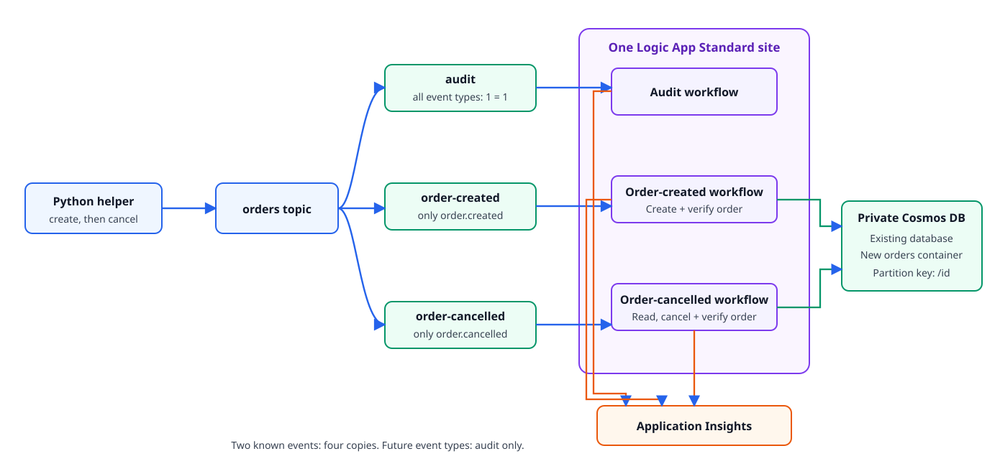

# Lab 2: Service Bus topic fan-out

Publish one `order.created` event and process independent copies in audit,
fulfillment, and notification workflows.

**Time:** 75 minutes. **Required:** [Lab 0](../00-foundation/README.md), not Lab 1.



## Start

Read the [implementation requirements](implementation-requirements.md),
[event schema](contracts/order-created.schema.json), and
[sample event](contracts/sample-order-created.json).
Initialize one track with the
[Bicep starter](https://github.com/scallighan/level-up-azure-integration-services/blob/main/.github/prompts/02-fanout-bicep.prompt.md)
or [Terraform starter](https://github.com/scallighan/level-up-azure-integration-services/blob/main/.github/prompts/02-fanout-terraform.prompt.md)
([how to invoke](../../docs/copilot-working-agreement.md#invoking-workshop-prompt-files)).
The starter creates files only; use the prompts below one at a time.

Reuse `.env` and `foundation.deployment.json`; set
`FOUNDATION_RESOURCE_GROUP_NAME` from the handoff.

```bash
set -a; source .env; set +a
```

For each change, have Copilot explain the resource graph, identities, files,
and checks before approval. Run Bicep format/build/what-if or Terraform
fmt/validate/plan; review the preview and artifact files before deploying.

## Step 0: reference the foundation

```text
Verify the Lab 0 handoff and configure existing-resource references for its
site, Service Bus namespace, and monitoring. Follow the Lab 2 requirements.
Do not change the foundation or add messaging, roles, connections, or workflows.
```

Run `bash scripts/verify-foundation.sh foundation.deployment.json`.
This step must produce no managed-resource changes.

## Task 1: add the messaging infrastructure

```text
Add only the orders topic, audit/fulfillment/notification subscriptions and
rules, managed-identity connection, and three subscription-scoped receiver
grants for the site's system identity. Follow the Lab 2 broker requirements.
Preserve the shared site and connections. Do not add workflow definitions.
```

Check exactly three subscriptions, filtered rules with `$Default` removed,
duplicate detection, and receiver grants scoped to individual subscriptions.

## Task 2: add the receivers

```text
Add only audit, fulfillment, and notification workflows, each receiving from
its assigned subscription. Use managed identity and peek-lock, complete only
after processing succeeds, and preserve retries and dead lettering.
Keep the actions lightweight and do not change infrastructure or grants.
```

## Task 3: publish and trace

After deploying Tasks 1 and 2, run from the repository root:

```bash
set -a; source .env; set +a
python3 scripts/test-lab2.py
```

The helper uses your current `az login` **user** and reuses the namespace-scoped
**Data Sender** grant created by Lab 0. It creates no grants and never changes
the site's permissions or enables SAS. If access is missing, repeat Lab 0
setup, preview, and deployment with the original foundation inputs.
RBAC propagation can take several minutes.

It sends the public sample once with fresh event/correlation IDs and timestamp,
sets the required broker/application properties, and checks matching runs and
successful message completion in `audit`, `fulfillment`, and `notification`.
Expect **one publication, three copies, and one successful run per workflow**.
Only statuses and identifiers are printed; no tokens or event bodies.
Existing payload-visibility settings remain unchanged.

Use `python3 scripts/test-lab2.py --dry-run` to preview without Azure requests.
The live test waits up to 180 seconds (`--timeout 300` extends this).
Failures exit nonzero with diagnostics. If a send's outcome is uncertain,
inspect the printed correlation ID before rerunning: each invocation creates
a new event rather than retrying the previous one.

Service Bus Explorer remains an optional alternative. Set
`ContentType=application/json`, `MessageId=eventId`, and the broker
`CorrelationId` to the body's `correlationId`; add string application
properties `eventType=order.created`, `schemaVersion=1.0`, and `correlationId`.

## Task 4: prove failure isolation

Ask Copilot for a controlled notification failure before completion, expected
delivery counts, and an exact revert. Send a new event with new IDs.
Audit and fulfillment must complete; only notification retries and eventually
dead-letters its copy. Revert the deliberate failure.

## Cleanup

Remove only Lab 2's topic and children, receiver grants, workflows, and
unused connection entry. Verify uploaded artifacts are removed even after
Terraform destroy. Preserve Lab 0's group, namespace, site, and other labs'
artifacts, including the Lab 0 student sender grant
([ownership details](implementation-requirements.md#implementation-sequence)).
