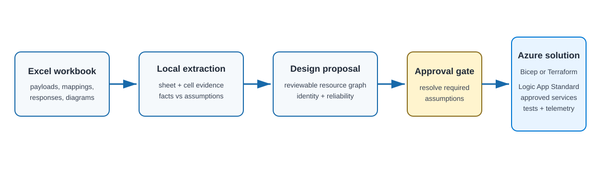

# Lab 3: Workbook to Azure integration solution

Turn a local workbook into an approved message flow, then implement it using
Logic App Standard and Service Bus. Mock all external systems.

**Time:** 90-150 minutes. **Required for Task 2:** [Lab 0](../00-foundation/README.md).



Read the [implementation requirements](implementation-requirements.md).
Keep evidence, images, proposals, and test notes in ignored `plans/`.
Never commit customer data or include secrets in plans.

## Task 1: propose and approve

Use this prompt with your local workbook path:

```text
Workbook: path/to/workbook.xlsx

Follow the Lab 3 evidence and workbook-interpretation requirements. Extract
the workbook locally with scripts/extract-integration-workbook.py and review
any embedded images. Create only the permitted Task 1 artifacts in plans/:
workbook evidence, a concise proposed integration-design.md, and its matching
integration-design.svg. Include cell evidence and unresolved flow conflicts.
Validate the SVG XML. Do not initialize IaC, implement, or deploy resources.
```

Review the tab mapping, message flow, and SVG locally. Resolve workbook/flow
conflicts, then set the plan's first line to `Status: approved`.
This approves the flow, not deployment-specific technical choices.

## Task 2: implement and test

Complete Lab 0 and keep its `.env` and `foundation.deployment.json`.
Initialize one track with the
[Bicep starter](https://github.com/scallighan/level-up-azure-integration-services/blob/main/.github/prompts/03-workbook-bicep.prompt.md)
or [Terraform starter](https://github.com/scallighan/level-up-azure-integration-services/blob/main/.github/prompts/03-workbook-terraform.prompt.md)
([how to invoke](../../docs/copilot-working-agreement.md#invoking-workshop-prompt-files)).
Then use this prompt:

```text
Implement plans/integration-design.md and its matching SVG in my selected
track, following the Lab 3 requirements. Stop if the plan is missing,
unapproved, or has unresolved flow conflicts. Reference Lab 0; preserve shared
resources, identities, and other labs' artifacts.

Before resource edits, explain the graph, identity scopes, files, costs, and
checks, resolve technical choices with me, and wait for approval. Implement
only the approved flow, Source helpers, sanitized fixtures, and mocks.
Run native checks and review the deployment preview with me before deploying.
```

Run each Source helper. Verify per-tab transformations and lookups, downstream
routing, failure/settlement behavior, and end-to-end correlation against mocks.
Keep final code/tests in the selected track and intermediate notes in `plans/`.

## Cleanup

Preview deletion and remove only Lab 3-owned resources, grants, workflow
artifacts, and unused connections. Verify uploaded artifacts are gone even
after Terraform destroy. Never delete Lab 0's group or shared foundation
([ownership details](implementation-requirements.md#cleanup-ownership)).
